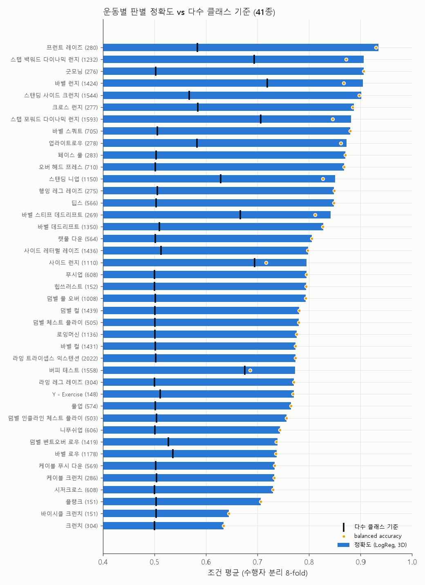
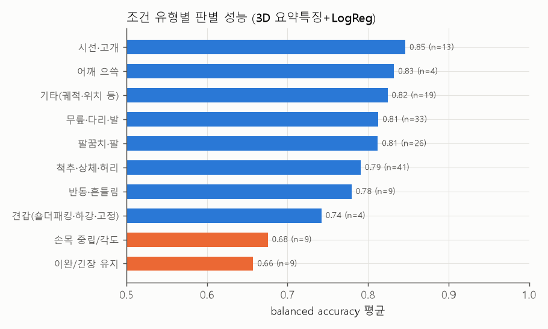
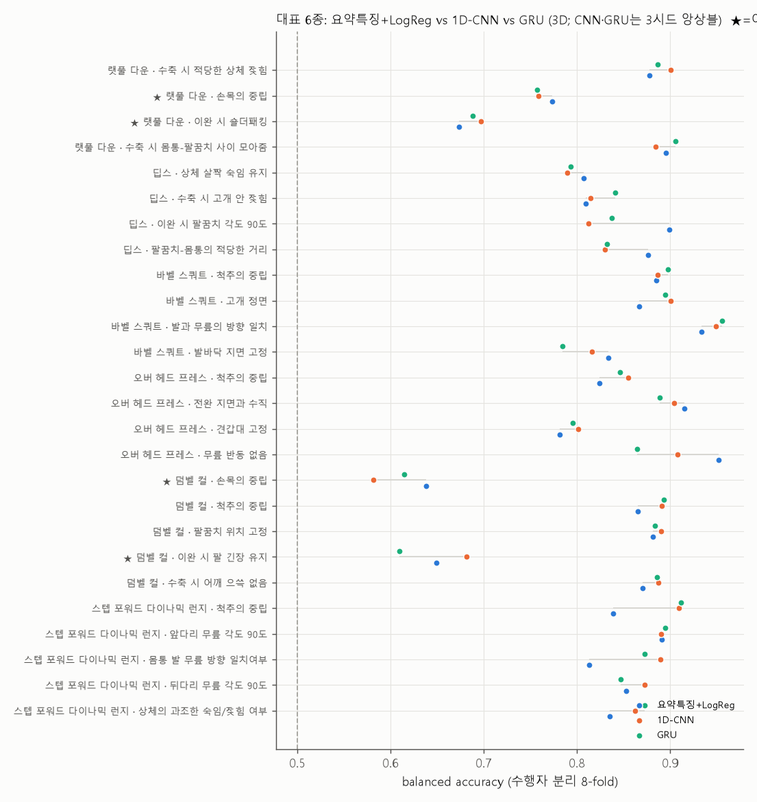
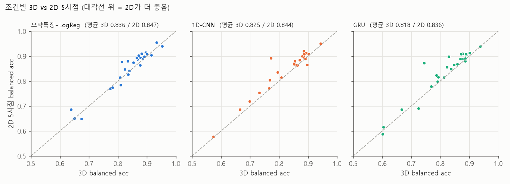
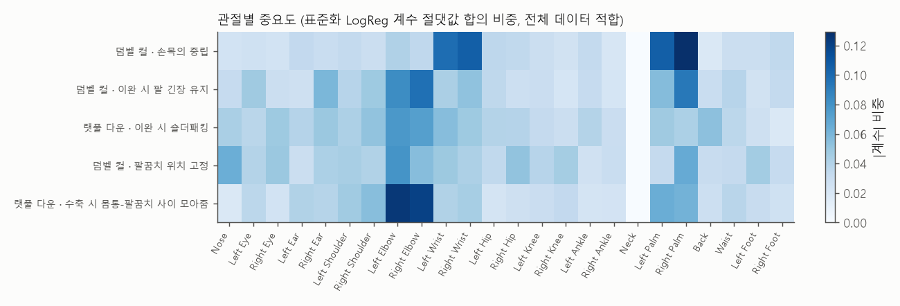
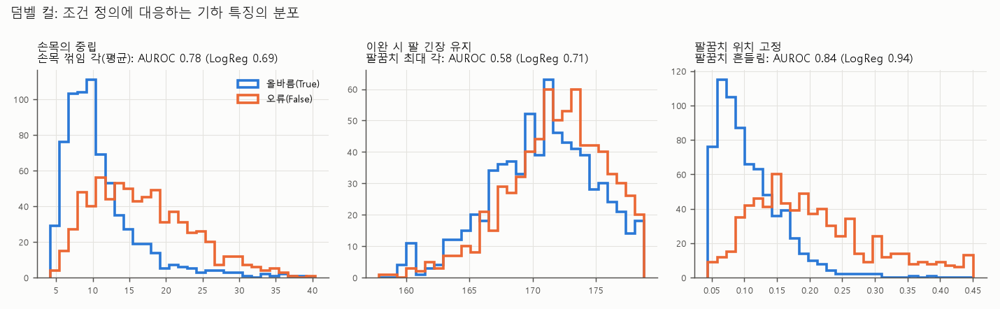
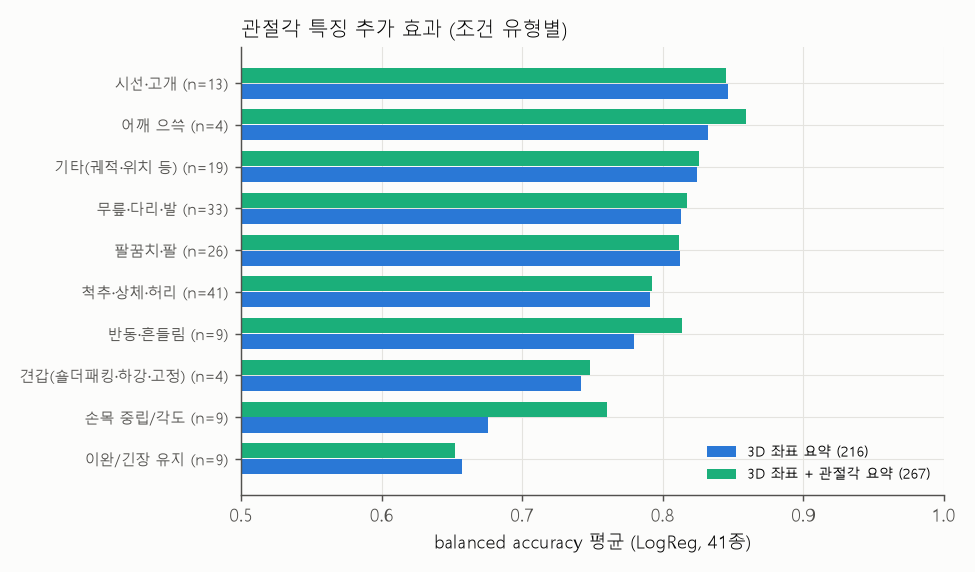

# 헬스 운동 자세 오류의 조건별 판별 가능성 분석 — 3D 키포인트 기반 딥러닝과 수행자 분리 평가

> 모든 수치는 `results/` 아래 CSV·로그와 `results/report_tables.md`(자동 생성, 표 번호 T0~T12)에서 가져왔습니다. 재현 방법은 §7을 참고하세요.

**핵심 결과 (수행자 분리 8-fold, 41종 167개 조건, 클립 31,982개)**
1. 3D 관절 좌표만으로 조건 평균 balanced accuracy 0.792(AUROC 0.858)이며, 89개 조건이 0.80 이상입니다. 시선·고개, 어깨 으쓱, 팔꿈치, 무릎 정렬은 잘 맞고, **손목 중립(0.675)과 이완 시 긴장 유지(0.657)가 가장 어렵습니다.**
2. 1D-CNN과 GRU(3시드 앙상블)는 요약 특징+LogReg와 평균이 비슷합니다(0.841 / 0.837 vs 0.836). 큰 운동에서는 낫고 작은 운동에서는 못하며, **어려운 조건은 개선하지 못했습니다.** 단일 시드로는 결론이 뒤집힐 수 있습니다.
3. **손목 중립은 "표현의 문제"입니다.** 손목 꺾임 각 하나가 216특징 LogReg보다 잘 가르고(9개 중 8개), 관절각을 특징에 넣으면 0.675→0.761로 개선됩니다.
4. **긴장 유지와 숄더패킹은 "관측의 문제"입니다.** 팔 긴장 유지 조건의 팔꿈치 각도 차이는 2° 미만이고, 시퀀스 모델이나 관절각 입력으로도 뚜렷한 개선이 없었습니다(덤벨 컬 긴장 유지 최고 0.682 vs LogReg 0.649, 랫풀 다운 숄더패킹 최고 0.711 vs 0.674, 3D 앙상블 기준 유의하지 않음).
5. 같은 클립에서 2D 5시점 결합이 3D보다 약간 낫습니다(0.802 vs 0.792). 카메라 1대로는 0.755~0.783입니다.

## 1. 문제 정의

홈트레이닝과 재활 운동이 늘면서 트레이너 없이 자세를 점검하려는 수요가 커졌지만, 카메라 기반 자세 교정이 모든 오류를 잡을 수 있는 것은 아닙니다. 본 연구는 공개 피트니스 자세 데이터에서 운동별 오류 조건(척추 중립, 어깨 으쓱, 손목 중립 등)이 **관절 좌표만으로** 얼마나 판별되는지를 **사람 단위로 분리해** 평가하고, 판별이 어려운 조건의 특징을 분석해 자동 피드백 설계의 한계와 방향을 제시합니다.

- **RQ1.** 운동·조건별로 3D 키포인트 시퀀스만으로 정/오류를 얼마나 판별할 수 있는가?
- **RQ2.** 요약 특징 + 선형 모델 대비 시퀀스 딥러닝(1D-CNN, GRU)은 어려운 조건(손목 중립, "이완 시 ~ 긴장 유지")에서 개선되는가?
- **RQ3.** 3D 좌표 대 2D 5시점(결합) 입력의 차이는?
- **RQ4.** 판별이 어려운 조건은 왜 어려운가?

**수업 예제와의 차별점.** 수업 노트북의 데이터·과제(MNIST·꽃 CNN, 시계열 RNN/LSTM 예측, 타이타닉, k-means, 센서 오토인코더 이상 탐지, GAN 등)를 사용하지 않습니다. 본 과제는 관절 좌표 시퀀스의 **조건별 다중 라벨 분류**이며, 평가는 **수행자 분리 교차검증**입니다.

## 2. 데이터

### 2.1 출처
AI Hub "피트니스 자세 이미지"(dataSetSn=231)의 **학습용 라벨 JSON만** 사용했습니다(영상 미사용). 받은 파일은 기구, 바벨·덤벨, 맨몸운동 라벨 tar 3개와 문서 tar 2개(명명규칙, 원천데이터 목록 및 시나리오)입니다. 소개 페이지는 "30종 동작"이라고 하지만 라벨의 운동명은 **41종**이며, 본 보고서는 라벨 기준 41종을 씁니다.

### 2.2 구조
- 클립 = JSON 1개 = **16프레임**. 2D 파일은 5개 시점(view1~5)마다 관절 24개의 (x, y)와 라벨(`type_info.conditions`)을 담고 있고, 같은 이름의 `-3d.json`은 관절 24개의 (x, y, z)를 담고 있습니다(라벨 없음).
- 운동마다 자세 조건이 3~5개 있고, 각 조건은 True(올바름) 또는 False(오류)입니다. 오류는 수행자가 지시에 따라 **일부러 연기**한 것입니다(시나리오 문서).
- **수행자** = `img_key`의 `-(Z\d+)_` 모델 코드. 파일명의 두 번째 숫자는 촬영 순서(슬롯)일 뿐 수행자가 아닙니다.

### 2.3 정제 규칙과 규모 (`count_data.py` → `logs/counts.json`)

| 데이터 | 2D JSON | 3D JSON | 2D만 | 3D만(라벨 없음) | 2D 16프레임 아님 | 3D 이상값 | 사용 가능 클립 | 수행자(Z) |
|---|---:|---:|---:|---:|---:|---:|---:|---:|
| 기구 | 4,262 | 4,262 | 0 | 0 | 9 | 0 | 4,253 | 32 |
| 바벨·덤벨 | 14,745 | 14,745 | 0 | 0 | 92 | 0 | 14,653 | 95 |
| 맨몸운동 | 15,461 | 16,423 | 1,119 | 2,081 | 186 | 1,080 | 13,076 | 62 |

- 제외 규칙: ① 프레임이 16개가 아닌 클립, ② 라벨이나 Z코드가 없는 클립, ③ 3D 짝이 없는 클립(3D 입력 실험), ④ **3D 이상값**(|좌표| > 10⁴ 또는 정규화 특징 |f| > 50; 맨몸 zip의 3D 복원 오류로 좌표가 10¹²~10¹⁴인 경우).
- 합계: **사용 가능 클립 31,982개, 운동 41종, 운동×조건 167개, 수행자 111명(그중 59명은 두 개 이상의 zip에 등장), 촬영일 32일.** 바벨 로우와 스탠딩 니업은 두 zip에 나뉘어 있어 운동명 기준으로 합쳤습니다.
- 2D 입력을 쓰는 실험은 3D가 없거나 3D 이상값인 클립도 쓸 수 있습니다(2,199개 추가 → 34,181개, 17종).

## 3. 방법

### 3.1 전처리
- **3D**: 프레임마다 Neck을 원점으로 옮기고, 클립 평균 어깨너비(좌우 어깨 거리)로 나눔 → (16, 24×3=72).
- **2D 5시점**: 시점마다 Neck을 원점으로 옮기고, 그 시점의 클립 평균 **몸통 길이(Neck–Waist)**로 나눈 뒤 5개 시점을 결합 → (16, 5×48=240). 측면 시점에서는 두 어깨가 겹쳐 2D 어깨너비가 거의 0이 되므로(최소 12.6px, 중앙값 약 90px) 2D에는 몸통 길이를 척도로 썼습니다.

### 3.2 모델 (운동마다 별도 학습)
| 모델 | 입력 | 구조 |
|---|---|---|
| 기준: 요약 특징 + 로지스틱 회귀 | 시퀀스의 평균·표준편차·가동범위 (3D 216차원 / 2D 720차원) | 표준화 + LogReg(C=0.1), 조건마다 이진 분류 |
| 1D-CNN | (16, F) 시퀀스 | GaussianNoise(0.05) → [Conv1D(64, k=3) → BN → ReLU]×2 → 전역 평균·최대 풀링 → Dropout(0.3) → Dense(조건 수, sigmoid) |
| GRU | (16, F) 시퀀스 | GaussianNoise(0.05) → GRU(64) → Dropout(0.3) → Dense(조건 수, sigmoid) |

- 딥러닝 모델은 **조건 전체를 한 번에 출력하는 다중 라벨 모델**입니다(binary cross-entropy, Adam 1e-3, batch 32, 최대 150 에폭). 학습 폴드 안에서 **수행자 15%를 떼어 검증 세트**로 쓰고 조기 종료(patience 15, 최적 가중치 복원)했습니다. 입력은 학습 폴드 통계로 표준화했습니다.
- TensorFlow 2.21 / Keras 3.15, CPU(8 논리 코어)에서 학습했습니다.

### 3.3 평가
- **수행자(Z코드) 분리 GroupKFold(8)**: 한 사람의 클립은 모두 같은 폴드에 들어갑니다. 같은 (운동, 클립 집합)에서는 **모든 모델과 입력이 같은 폴드**를 씁니다.
- 지표: 조건별 accuracy, **balanced accuracy**, macro-F1, AUROC(아웃오브폴드 예측을 모아 계산)와 다수 클래스 기준선. 조건 라벨이 한쪽으로 치우친 운동(런지류, 버피, 스탠딩 니업, 바벨 로우 등)이 있어 balanced accuracy를 주 지표로 썼습니다.
- 모델 간 차이는 **수행자 단위 부트스트랩(1,000회)** 으로 95% 신뢰구간을 구했습니다.
- **기준 모델 재현**: 핸드오프의 `analyze_fitness.py`를 다시 실행해 기존 결과(`baseline_results_all.csv`, 176개 운동×조건)와 비교했습니다. 클립 수와 수행자 수는 176/176 일치했고, 정확도 차이는 최대 0.0018이었습니다(`results/baseline_repro_compare.csv`).

## 4. 결과

### 4.1 RQ1 — 3D 키포인트만으로 조건을 얼마나 판별하는가 (41종, 기준 모델)



- 167개 운동×조건에서 balanced accuracy는 **평균 0.792(중앙값 0.807), AUROC 평균 0.858**입니다. 89개 조건(53%)이 0.80 이상이고 21개 조건이 0.65 미만입니다(표 T0).
- 정확도가 **다수 클래스 기준 이하인 조건은 2개**뿐이고, 둘 다 라벨이 한쪽으로 치우친 조건입니다. 버피 테스트 "가슴의 충분한 이동"(올바름 78%, 정확도 0.773 vs 기준 0.783)과 사이드 런지 "몸통 발 무릎 방향 일치"(81%, 0.793 vs 0.811)입니다. 두 조건 모두 AUROC는 0.72대여서 순위 정보는 있지만 0.5 임계값에서는 다수 클래스를 넘지 못합니다.
- 운동 단위 상위는 프런트 레이즈(0.930), 굿모닝(0.906), 스탠딩 사이드 크런치(0.898)입니다. 하위는 크런치(0.634), 바이시클 크런치(0.644), 버피 테스트(0.685), 플랭크(0.706)입니다. 하위 운동 대부분은 **누운/엎드린 자세이고 수행자가 19명뿐인** 맨몸 운동이라, 자세의 어려움과 데이터 부족이 섞여 있습니다(표 T1).



- **조건 유형별(표 T2)**: 시선·고개 0.846, 어깨 으쓱 0.832, 팔꿈치·팔 0.812, 무릎·다리·발 0.813, 척추·상체·허리 0.791 순으로 높습니다. **손목 중립/각도 0.675와 이완/긴장 유지 0.657이 가장 낮습니다.** 핸드오프 단계 관찰과 같은 패턴입니다.

### 4.2 RQ2 — 시퀀스 딥러닝은 어려운 조건을 개선하는가 (대표 6종)



대표 6종은 랫풀 다운, 딥스, 바벨 스쿼트, 오버 헤드 프레스, 덤벨 컬, 스텝 포워드 다이나믹 런지로, 클립 5,577개와 조건 26개입니다.

**(a) 시드 견고성 (표 T3b).** CNN·GRU를 시드 3개로 학습했습니다.
- **단일 시드에서는 CNN 0.823~0.830, GRU 0.815~0.825로 LogReg(0.836)보다 낮습니다.**
- **3시드 확률 평균(앙상블)에서는 CNN 0.841, GRU 0.837로 LogReg와 비슷하거나 약간 높습니다.**
- 조건별 시드 간 표준편차는 평균 0.011~0.012(최대 0.029)입니다. 학습 무작위성이 모델 간 차이와 같은 크기라서 **시드 1개로는 결론을 낼 수 없습니다.** 이후 CNN·GRU 수치는 3시드 앙상블입니다.

**(b) 전체 비교 (표 T3, T4).** 평균 balanced acc는 LogReg 0.836, CNN 0.841, GRU 0.837이고 AUROC는 0.901, 0.910, 0.900입니다. 평균으로는 거의 같지만 조건별로는 갈립니다. LogReg 대비 수행자 부트스트랩 95% CI 기준(다중비교 보정 없음)으로 CNN은 유의하게 좋음 6, 나쁨 4, 차이 없음 16이고, GRU는 좋음 6, 나쁨 6, 차이 없음 14입니다.
- 시퀀스 모델이 **유의하게 좋은 조건**: 스텝 포워드 런지 "척추의 중립"(LogReg 0.838 → CNN 0.909 / GRU 0.912)과 "몸통 발 무릎 방향 일치"(0.813 → 0.889 / 0.873), 덤벨 컬 "척추의 중립"(0.865 → 0.891 / 0.893). 이 중 두 운동은 클립이 가장 많습니다(1,439, 1,593).
- 시퀀스 모델이 **유의하게 나쁜 조건**: 딥스 "이완 시 팔꿈치 각도 90도"(0.899 → 0.812 / 0.837), 오버 헤드 프레스 "무릎 반동 없음"(0.952 → 0.908 / 0.865). 둘 다 수행자 32~44명, 클립 약 560~710개인 작은 운동입니다.
- 정리하면, **데이터가 큰 운동에서 시간 정보가 도움이 되고 작은 운동에서는 요약 특징+선형 모델이 더 안정적입니다.**

**(c) 어려운 조건 (표 T5).** 손목 중립, 이완 시 긴장 유지, 숄더패킹 4개의 평균은 **LogReg 0.683, CNN 0.680, GRU 0.667로 개선되지 않았습니다.** 덤벨 컬 "손목의 중립"은 CNN이 오히려 유의하게 낮습니다(0.638 → 0.582). 시간 순서를 보는 모델로 바꾸는 것만으로는 어려운 조건이 풀리지 않습니다. 원인 분석은 §4.4에 있습니다.

**(d) 입력 표현을 바꾸면 (표 T11).** §4.4에서 찾은 관절각 특징(프레임별 관절각 15개 + 귀–어깨 거리 2개)을 시퀀스에 붙여 같은 폴드로 다시 학습했습니다(시드 0끼리 비교).

| | LogReg | 1D-CNN | GRU |
|---|---|---|---|
| 어려운 조건 4개, 3D 좌표 | 0.683 | 0.667 | 0.649 |
| 어려운 조건 4개, 3D 좌표 + 관절각 | 0.723 | 0.731 | 0.705 |
| 전체 26개, 3D 좌표 | 0.836 | 0.825 | 0.818 |
| 전체 26개, 3D 좌표 + 관절각 | 0.846 | 0.842 | 0.835 |

- 손목 중립은 모든 모델에서 크게 개선됩니다. 랫풀 다운은 LogReg 0.773→0.860, CNN 0.732→0.835이고, 덤벨 컬은 LogReg 0.638→0.719, CNN 0.573→0.703입니다.
- **이완 시 긴장 유지와 숄더패킹은 입력을 바꿔도 그대로입니다.** 덤벨 컬 긴장 유지는 LogReg 0.649→0.648, 랫풀 다운 숄더패킹은 0.674→0.663입니다.
- **RQ2의 답:** 어려운 조건의 개선은 모델 구조(시퀀스 vs 요약)가 아니라 **입력 표현**에서 나왔고, 그 효과도 손목처럼 "정보가 키포인트에 있는" 조건에만 해당합니다.

### 4.3 RQ3 — 3D 좌표 vs 2D 5시점



- **같은 클립·같은 폴드에서 2D 5시점 결합이 3D보다 조금 낫습니다.**
  - 41종 LogReg: balanced acc **0.792(3D) vs 0.802(2D 5시점)**, AUROC 0.858 vs 0.864 (표 T7)
  - 대표 6종: LogReg 0.836→0.847, 1D-CNN 0.825→0.844, GRU 0.818→0.836 (시드 0, 표 T6)
- 2D에서 3D보다 특히 높은 조건은 바벨 스쿼트 "발바닥 지면 고정"(LogReg 0.834→0.880, CNN 0.772→0.892)과 스텝 포워드 런지 "몸통 발 무릎 방향"(LogReg 0.813→0.878)입니다. 발과 지면의 접촉처럼 3D 복원에서 뭉개지기 쉬운 정보로 보입니다.
- **2D 전용 클립(3D 없음 또는 3D 이상값) 2,199개를 추가해도**(31,982→34,181클립) 평균은 0.801로 변화가 없습니다. 클립 수보다 수행자 수가 성능을 제한한다는 해석과 맞습니다(표 T7).
- 해석: 3D 좌표는 다시점 2D에서 복원된 값으로 보이고(생성 방식은 문서에 없음), 5개 시점을 함께 쓰면 3D가 담은 정보에 복원 오차가 없는 원 관측까지 더해집니다. 맨몸 zip에서 복원 실패(3D 이상값 1,080개)가 실제로 관찰된다는 점도 이 해석과 일관됩니다(검증은 하지 않음).
- **카메라 1대(단일 시점)** 로는 0.755~0.783입니다(시점 B 최고, 시점 C 최저; 표 T12). 5시점 결합 대비 0.02~0.05 낮고, 손목 중립은 0.640~0.680, 이완/긴장 유지는 0.619~0.641로 더 떨어집니다. 홈트레이닝처럼 카메라가 1대인 환경에서는 시점 선택이 성능에 영향을 줍니다.

### 4.4 RQ4 — 어려운 조건은 왜 어려운가



**(a) 관절 중요도 (표 T8).** 덤벨 컬 "손목의 중립" 모델의 계수 비중은 Right Palm 0.129, Right Wrist 0.106, Left Palm 0.105, Left Wrist 0.099로 **손목과 손바닥 관절에 집중**됩니다. 즉, 모델은 올바른 관절을 보고 있지만 그 정보를 충분히 쓰지 못합니다.



**(b) 조건 정의에 대응하는 기하 특징 1개 (표 T9).** 학습 없이 미리 정한 특징 1개로 AUROC를 쟀습니다.
- **손목 꺾임 각**(전완 연장선과 Wrist→Palm 벡터 사이 각도의 클립 평균): 손목 조건 9개에서 AUROC **0.705~0.886**입니다. **9개 중 8개에서 216특징 LogReg(0.675~0.852)보다 높습니다.** 오류(False) 클립의 평균 꺾임이 더 크고(예: 덤벨 벤트오버 로우 9.6° vs 19.5°), 덤벨 풀 오버만 방향이 반대입니다.
- **팔꿈치 최대 각**(가장 펴졌을 때): "이완 시 팔 긴장 유지" 4개에서 AUROC **0.521~0.584로 거의 무작위**입니다. 올바름/오류의 평균 차이는 0.5~1.7°에 불과합니다.
- 대조군인 쉬운 조건 "팔꿈치 위치 고정"은 팔꿈치 흔들림 하나로 AUROC 0.619~0.841입니다.



**(c) 관절각을 특징으로 추가 (표 T10).** 3D 좌표 요약(216)에 프레임별 관절각 15개와 귀–어깨 거리 2개의 요약(51)을 더해 같은 폴드로 다시 평가했습니다.
- **손목 중립/각도: 0.675 → 0.761 (9개 모두 개선).** 덤벨 벤트오버 로우 0.631→0.812, 바벨 로우 0.639→0.771, 랫풀 다운 0.773→0.860입니다.
- 반동·흔들림 0.779→0.814, 어깨 으쓱 0.832→0.859도 좋아졌습니다.
- **이완/긴장 유지: 0.657 → 0.652(변화 없음)**, 견갑 0.742→0.748입니다.
- 전체 167개 조건은 0.792→0.801(개선 98, 하락 67)입니다. 하락 상위는 수행자 19명인 작은 운동(Y-Exercise, 플랭크, 크런치)입니다.

**종합.** 어려운 조건은 두 종류로 나뉩니다.
1. **표현의 문제(손목 중립):** 정보는 키포인트(Wrist–Palm)에 있지만, 손 벡터가 어깨너비 대비 매우 작고 각도가 좌표의 비선형 함수여서 좌표 요약+선형 모델이 꺼내지 못했습니다. 관절각이라는 도메인 지식 특징을 넣으면 크게 개선됩니다.
2. **관측의 문제(이완 시 긴장 유지, 숄더패킹):** "긴장"은 근육 상태이고, 관절 각도에는 2° 미만의 차이로만 남습니다. 관절각을 넣어도, 시퀀스 모델을 써도 뚜렷이 개선되지 않았습니다(§4.2: 덤벨 컬 긴장 유지 최고 0.682 vs LogReg 0.649, 랫풀 다운 숄더패킹 최고 0.711 vs 0.674). 숄더패킹(견갑골 후인·하강)도 24관절에 견갑골 점이 없어 직접 관측되지 않습니다. 이런 조건은 키포인트 기반 자동 피드백의 대상에서 빼거나, 근전도·고해상도 영상 같은 다른 신호가 필요합니다.

**오분류 사례.** `figures/fig6_cases_*.png`는 각 어려운 조건에서 가장 확신 있게 맞힌 사례와 틀린 사례의 골격(프레임 1·9·16)과 손목 궤적입니다. 클립 목록은 `results/tables/misclassified_cases.csv`에 있습니다.

## 5. 한계

1. **연기된 오류.** 오류는 수행자가 지시에 따라 일부러 수행한 것이고(시나리오 문서), 조건은 거의 모든 조합이 촬영되도록 설계됐습니다. 실제 사용자의 미묘하고 섞인 실수보다 판별이 쉬울 수 있어, 본 수치는 **상한에 가까운 추정**으로 봐야 합니다.
2. **입력 정보의 한계.** 영상 없이 24관절 좌표만 썼습니다. 손가락·견갑골·발바닥 점이 없고, 3D 좌표의 단위와 생성 방식이 문서에 없으며, 일부 3D 복원 오류(이상값 1,080개)가 있습니다. 2D 시점 A~E의 카메라 위치도 문서에 없습니다.
3. **시간 해상도.** 클립은 16프레임으로 고정이고 동작 1회 전체가 아닐 수 있습니다. "이완 시 ~"처럼 동작 구간에 따른 조건은 해당 구간이 클립에 충분히 담기지 않았을 수 있습니다.
4. **모델 탐색 범위.** 시퀀스 모델은 대표 6종에만, 작은 구조 하나(1D-CNN, GRU 각 1개)로 하이퍼파라미터 탐색 없이 학습했습니다. 시드 3개로 학습 무작위성을 확인했지만(§4.2) 더 큰 모델, 사전학습, 운동 간 공유 학습은 시험하지 않았습니다.
5. **라벨 불균형.** 런지류, 버피, 스탠딩 니업, 바벨 로우 등은 조건 조합이 불완전해 한쪽 라벨이 많습니다. 그래서 balanced accuracy를 주 지표로 썼지만, 해당 운동의 정확도 수치는 주의해서 해석해야 합니다.
6. **수행자 식별 가정.** Z코드가 같으면 같은 사람이라고 가정했습니다. 촬영일 간 동일인인지는 확인하지 못했고, 수행자 성별·연령·체형 분포를 알 수 없어 일반화 범위가 불명확합니다. 일부 운동은 수행자가 19명뿐이라 폴드당 테스트 수행자가 2~3명입니다.
7. **조건 유형 분류**는 조건 이름의 키워드로 나눈 대략적 분류입니다(`results/tables/condition_types.csv`).
8. 핸드오프의 기존 결과(176개 조건)는 바벨 로우와 스탠딩 니업을 zip별로 따로 평가했고, 본 보고서의 41종 표는 운동명으로 합쳐서 평가했습니다(167개 조건).

## 6. 결론

- **RQ1:** 3D 관절 좌표만으로도 167개 조건 중 89개가 balanced accuracy 0.80 이상으로 판별됩니다(평균 0.792, 수행자 분리). 시선·고개, 어깨 으쓱, 팔꿈치, 무릎·발 정렬처럼 **큰 관절의 위치·각도로 정의되는 오류는 자동 피드백 후보**입니다.
- **RQ2:** 1D-CNN과 GRU는 3시드 앙상블일 때 요약 특징+LogReg와 평균이 비슷합니다(0.841 / 0.837 vs 0.836). 데이터가 큰 운동(런지, 덤벨 컬)의 척추·정렬 조건에서는 낫고, 작은 운동(딥스, 오버 헤드 프레스)에서는 못합니다. **어려운 조건은 시퀀스 모델로 개선되지 않았고**, 관절각 특징을 넣었을 때만 손목 중립이 개선됐습니다(어려운 조건 평균 CNN 0.667→0.731, 시드 0).
- **RQ3:** 같은 클립에서 2D 5시점 결합이 3D보다 조금 낫고(0.802 vs 0.792), 카메라 1대로는 0.755~0.783으로 떨어집니다.
- **RQ4:** 어려운 조건은 **표현의 문제(손목 중립: 관절각을 넣으면 0.675→0.761)** 와 **관측의 문제(이완 시 긴장 유지, 숄더패킹: 시퀀스 모델·관절각으로도 뚜렷한 개선 없음)** 로 나뉩니다. 서비스 설계에서는 전자를 도메인 특징으로 보강하고, 후자는 키포인트 기반 피드백 대상에서 빼거나 다른 센서를 써야 합니다.

## 7. 재현 방법

```
python prepare_data.py data dataset/기구.tar "dataset/바벨,덤벨.tar" dataset/맨몸운동.tar "dataset/데이터 명명규칙.tar" "dataset/원천데이터 목록 및 시나리오.tar"
python count_data.py data --out logs/counts.json                     # §2.3 표
python analyze_fitness.py data/기구 --no-rf --out results/baseline_repro_기구.json   # 3개 데이터셋 각각 (기준 재현)
python compare_baseline.py                                           # 기존 CSV 대비 ±0.02
python build_cache.py data --out cache                               # 이후 실험 공통 캐시
python exp_seq.py --input 3d --exercises all --models logreg --out results/all_logreg_3d_paired     # 41종 (2d, 2d all2d, 3d_ang, 2dv1~5 도 같은 방식)
python exp_seq.py --input 3d --exercises rep6 --models logreg,cnn,gru --out results/rep6_3d         # 대표 6종 (--seed 100/200 → rep6_3d_seed1/2, --input 2d / 3d_ang)
python analyze_results.py                                            # figures/, results/tables/, results/report_tables.md
```

- 환경: Python 3.12.6, scikit-learn 1.9.1, TensorFlow 2.21.0 / Keras 3.15.1, CPU 8 논리 코어. 대표 6종 3D 실험(3개 모델, 8폴드)은 약 18분 걸렸습니다.
- 로그는 `logs/`, 조건별 결과 CSV와 아웃오브폴드 예측(`*_oof.npz`)은 `results/`에 있습니다.
